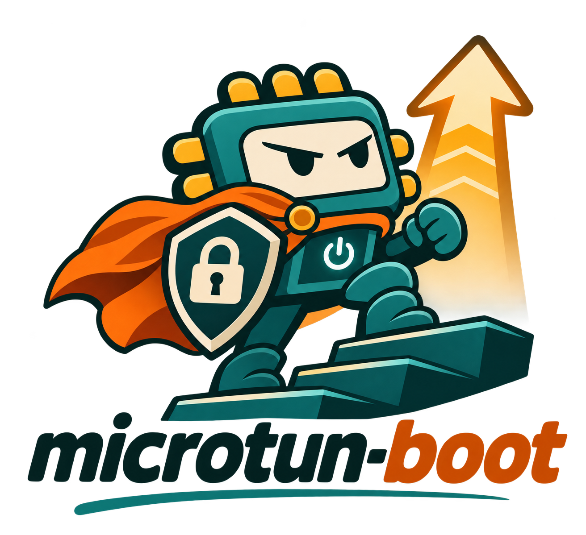

# microtun boot

<p align="center">
  
</p>

A secure boot bootloader written in Rust, compatible with
[MCUboot](https://github.com/mcu-tools/mcuboot)'s on-flash formats, so
`imgtool sign` output works unchanged. On every boot it authenticates the
application before starting it, carries out any pending upgrade, and never
boots an image that fails verification.

- **Signatures:** ECDSA P-256 over SHA-256 only. Encrypted and compressed
  images are rejected.
- **Upgrade strategies:** swap-using-scratch (test/permanent, revert,
  power-fail resume), overwrite-only, direct-XIP with or without revert.
- **Policy:** downgrade prevention, minimum version, hardware security counter
  (anti-rollback; temporarily disabled on ESP32-C5), imgtool `--vid`/`--cid`.
- **Boards:** [ESP32-C3 SuperMini](boards/esp32c3-supermini/README.md),
  [ESP32-C5-DevKitC-1](boards/esp32c5-devkitc-1/README.md) (4, 8 or 16 MiB
  flash),
  [RP2350 Pico 2 / Pico 2 W](boards/rp2350-pico2/README.md) and
  [QEMU](boards/qemu/README.md) (tests only).

microtun boot is an experimental prototype and an independent project, not
affiliated with MCUboot. Read [SECURITY.md](SECURITY.md) and
[THREAT-MODEL.md](THREAT-MODEL.md) before using it in a product.

## Where to start

- **Run an application on a released bootloader:** follow the
  [ESP32-C3](examples/esp32c3-supermini-blinky/README.md),
  [ESP32-C5](examples/esp32c5-devkitc-1-blinky/README.md) or
  [RP2350](examples/rp2350-pico2-blinky/README.md) blinky example.
- **Build and flash your own bootloader:** follow the board README.
- **Try it without hardware:** use the [QEMU board](boards/qemu/README.md).

## Requirements

You need Rust **1.95+**, `imgtool` and the
[microtun-signer](https://github.com/microtun/microtun-signer) CLI (0.13+) on
your `PATH`. Each board README lists its Rust target and any extra tools.

```sh
python3 -m pip install imgtool
cargo test            # host-side tests; no hardware needed
```

All signing goes through `microtun-signer`, using development keys on your
machine by default or a signer service for release keys. See
[SIGNING.md](SIGNING.md).

## Building

Build embedded images from inside a board or example directory, which selects
the right target. `cargo run --release` there builds, signs and flashes;
`NO_FLASH=1` stops after signing:

```sh
cd boards/esp32c3-supermini/firmware
NO_FLASH=1 cargo run --release
```

Never use `cargo build --workspace` for embedded images: it mixes incompatible
targets.

## Repository layout

| Path | Contents |
|---|---|
| [`microtun-boot-core`](microtun-boot-core/README.md) | Platform-independent boot logic and the application-side updater |
| [`microtun-boot-esp`](microtun-boot-esp/README.md), [`microtun-boot-rp`](microtun-boot-rp/README.md), [`microtun-boot-qemu`](microtun-boot-qemu/README.md) | Platform crates for bootloaders and applications, each with its host tool in its own `tools/` subdirectory |
| [`microtun-boot-build`](microtun-boot-build/README.md) | `build.rs` helpers and shared signing code |
| [`chips/`](chips/README.md) | Per-chip constants |
| `boards/` | Bootloader, test firmware and flash layout per board |
| `examples/` | Standalone application examples |
| [`testing/`](testing/microtun-boot-hil/README.md) | Hardware-in-the-loop and QEMU tests |

## Tests

[`microtun-boot-hil`](testing/microtun-boot-hil/README.md) flashes complete boot
chains and checks the boot output. The full regression suite runs under QEMU;
physical boards run a smoke suite and need an expendable board.

## Contributing

Contributions are welcome. Before a contribution can be merged, the contributor
must complete the applicable Contributor License Agreement (CLA). Contributions
made on behalf of an employer or other organization may also require an entity
CLA or equivalent authorization. See [`CONTRIBUTING.md`](CONTRIBUTING.md), the
[`Individual CLA`](https://github.com/microtun/legal/blob/main/CLA-INDIVIDUAL.md), and the [`Entity CLA`](https://github.com/microtun/legal/blob/main/CLA-ENTITY.md)
for details.

## License

microtun boot is **dual-licensed**:

- **Noncommercial license:** the [PolyForm Noncommercial License
  1.0.0](LICENSE), including its provisions for qualifying noncommercial
  organizations. This is a source-available license, **not an open-source
  license**.
- **Commercial license:** a separate written agreement, available on request.
  Commercial rights come only from that agreement, not from the PolyForm
  Noncommercial License and not merely from making a request.
